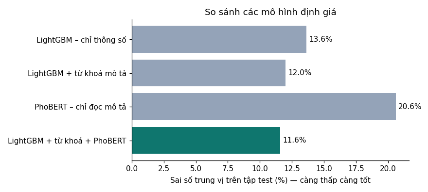
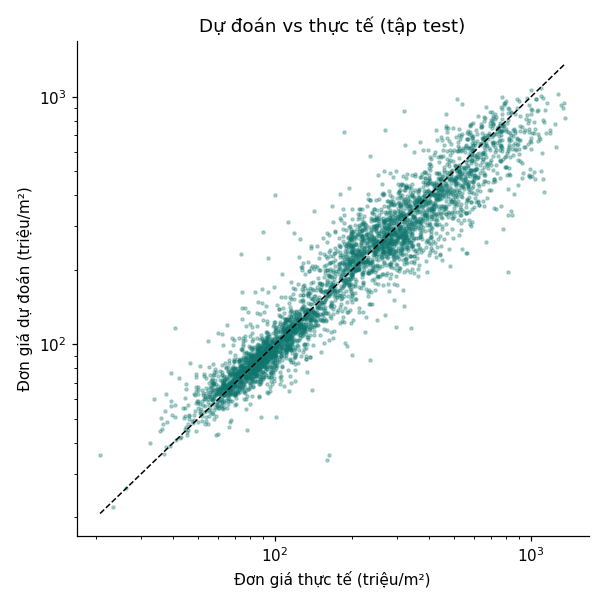
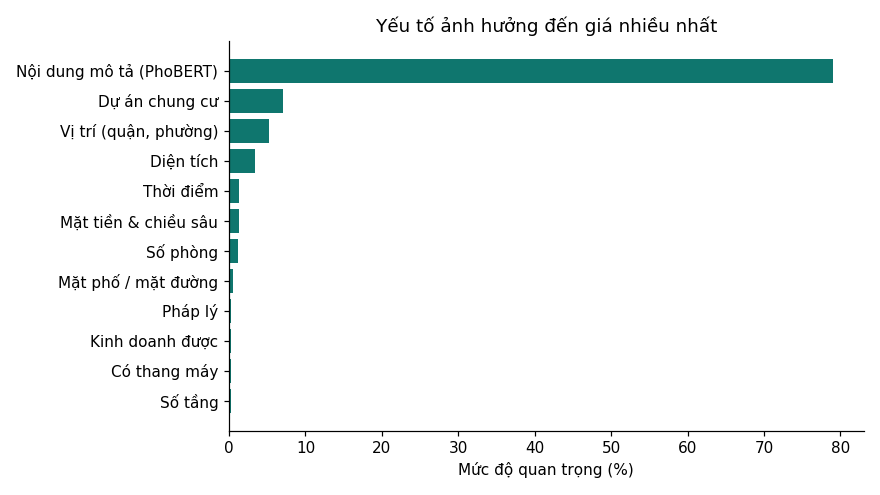
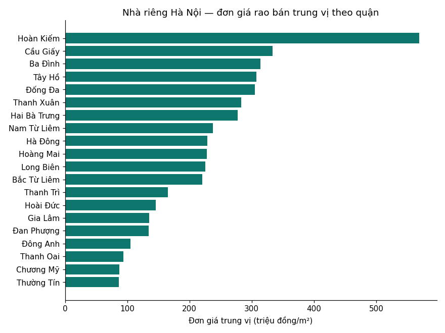

# 🏠 Định giá nhà đất Hà Nội bằng AI

**Demo trực tuyến:** https://dinh-gia-nha-ha-noi.streamlit.app  
**Mô hình:** https://huggingface.co/Qdunq05/dinh-gia-nha-ha-noi

Ứng dụng web giúp ước tính giá **nhà riêng** và **căn hộ chung cư** tại Hà Nội. Người dùng nhập vị trí, diện tích, số tầng, mặt tiền,
pháp lý, đặc điểm nổi bật và mô tả tự do. Mô hình trả về:

- **Giá ước tính** kèm **khoảng giá hợp lý 80%**
- **Đơn giá/m²** so với trung vị của phường, quận và toàn thành phố
- **Các yếu tố làm giá cao hoặc thấp hơn** (ví dụ: ô tô đỗ cửa +12%, chưa có sổ −15%)
- **Tin rao tương tự** trong khu vực để đối chiếu

Mô hình sử dụng **LightGBM** học từ thông số + từ khoá, kết hợp với **PhoBERT** (`vinai/phobert-base-v2`) được fine-tune để đọc hiểu mô tả tin rao tiếng Việt.

## Kết quả

Kiểm tra trên **15.337 tin đăng sau ngày 2026-02-01**, là những tin mô hình chưa từng thấy khi huấn luyện
(chia theo thời gian, giống tình huống định giá thực tế).

| Mô hình | Sai số trung vị | MAPE | Lệch ≤ 10% | Lệch ≤ 20% |
|---|---|---|---|---|
| LightGBM – chỉ thông số | 13,6% | 21,3% | 40,6% | 63,1% |
| LightGBM + từ khoá mô tả | 12,0% | 18,4% | 43,8% | 68,1% |
| PhoBERT – chỉ đọc mô tả | 20,6% | 24,1% | 24,2% | 48,5% |
| LightGBM + từ khoá + PhoBERT | 11,6% | 16,8% | 45,0% | 70,7% |

➡️ Mô hình cuối (**LightGBM + từ khoá + PhoBERT**) giảm **15%** sai số trung vị so với mô hình chỉ dùng thông số cơ bản.

Kết quả theo loại bất động sản (mô hình cuối):

| Loại | Sai số trung vị | MAPE | Lệch ≤ 10% | Lệch ≤ 20% |
|---|---|---|---|---|
| Chung cư | 7,6% | 10,9% | 60,9% | 85,9% |
| Nhà riêng | 15,8% | 20,9% | 34,0% | 60,1% |

Độ phủ thực tế của khoảng giá 80% trên tập test: Chung cư: 75%, Nhà riêng: 76%.






## Dữ liệu

- Nguồn: [tinixai/vietnam-real-estates](https://huggingface.co/datasets/tinixai/vietnam-real-estates) (CC BY-NC 4.0), tin rao bán từ 2025-06-01 đến 2026-03-30.
- Lọc Hà Nội, giữ nhà riêng và chung cư; loại tin thiếu giá hoặc diện tích, đơn giá bất thường, tin đăng trùng lặp, và ngoại lai theo từng quận.
- Sau khi làm sạch: **178.757** tin.

## Phương pháp

1. **Làm sạch và loại trùng:** một tin thường được đăng lại nhiều lần; nếu không loại, tập test sẽ chứa tin đã thấy khi train và kết quả bị đẹp giả.
2. **Che giá trong văn bản:** nhiều tin ghi sẵn "giá 7,4 tỷ" trong tiêu đề; mọi con số giá được thay bằng `[giá]` trước khi đưa vào mô hình để tránh **rò rỉ dữ liệu**.
3. **Đặc trưng:**
   - Thông số: diện tích, số tầng, diện tích sàn, mặt tiền, độ rộng ngõ, số phòng, hướng nhà
   - Vị trí: quận, phường, dự án chung cư
   - Thời điểm đăng tin
   - 12 từ khoá nghiệp vụ trích từ mô tả: ô tô đỗ cửa, kinh doanh, lô góc, thang máy, pháp lý…
4. **PhoBERT:** fine-tune để dự đoán log(đơn giá) chỉ từ văn bản tiêu đề và mô tả.
5. **Xếp chồng mô hình (stacking) không rò rỉ:** PhoBERT học trên phần A của tập train; LightGBM học trên phần B, dùng dự đoán của PhoBERT làm một đặc trưng.
6. **Giải thích:** tác động của từng yếu tố được tính bằng SHAP (`pred_contrib` của LightGBM), quy đổi ra % giá.
7. **Khoảng giá 80%:** lấy theo phân phối sai số trên tập validation, tính riêng cho từng loại bất động sản.

## Cấu trúc thư mục

```
├── dinh_gia_nha_ha_noi.ipynb   # notebook Colab: dữ liệu → train → đánh giá → deploy
├── streamlit_app.py            # giao diện web (Streamlit)
├── hf_repo.txt                 # tên kho mô hình trên Hugging Face
├── features.py                 # xử lý dữ liệu & đặc trưng (dùng chung cho train và app)
├── requirements.txt
└── outputs/                    # biểu đồ kết quả
```

## Chạy lại

Mở notebook trên Google Colab, chọn GPU T4 rồi bấm **Runtime → Run all**. Notebook tự tải dữ liệu, huấn luyện, đưa mô hình lên Hugging Face (`sdfghedrhgr/dinh-gia-nha-ha-noi`) và tạo gói file cho repo này. Web demo chạy trên Streamlit Community Cloud, tự tải mô hình từ Hugging Face khi khởi động.

## Hạn chế & hướng phát triển

- Dữ liệu là **giá rao bán**, thường cao hơn giá giao dịch thực tế.
- Dữ liệu còn dùng địa giới quận/huyện cũ (trước khi sáp nhập đơn vị hành chính từ 01/07/2025).
- Chưa có toạ độ: có thể bổ sung khoảng cách tới trung tâm, ga metro, trường học bằng geocoding.
- Có thể tách từ tiếng Việt (VnCoreNLP) trước khi đưa vào PhoBERT, thử PhoBERT-large, hoặc thêm ảnh nhà (mô hình đa phương thức).
- Theo dõi biến động giá theo thời gian và tự động huấn luyện lại hằng tháng.
